<div align="center">

<a href="https://github.com/Zero521">
  
</a>

<br />

<a href="https://github.com/Zero521?tab=repositories"></a>
&nbsp;
<a href="https://github.com/Zero521?tab=followers"></a>

<br /><br />

<sub>REVERSE ENGINEERING &nbsp; / &nbsp; BINARY ANALYSIS &nbsp; / &nbsp; LOW-LEVEL DEVELOPMENT</sub>

</div>

<br />

### `01` &nbsp; / &nbsp; About

```yaml
handle: Zero521
role: Reverse Engineer
focus:
  - Reverse engineering
  - Binary analysis & debugging
  - Low-level development
languages: [C, C++, C#, Python, Java]
```

### `02` &nbsp; / &nbsp; Toolbox

<p>
  
  
  
  
  
</p>

### `03` &nbsp; / &nbsp; Find me

[**github.com/Zero521 ↗**](https://github.com/Zero521) &nbsp; · &nbsp; [Repositories](https://github.com/Zero521?tab=repositories) &nbsp; · &nbsp; [Activity](https://github.com/Zero521?tab=overview)

---

<div align="center">
  <sub><code>Zero521</code> &nbsp; / &nbsp; Read the bytes. Understand the system.</sub>
</div>
